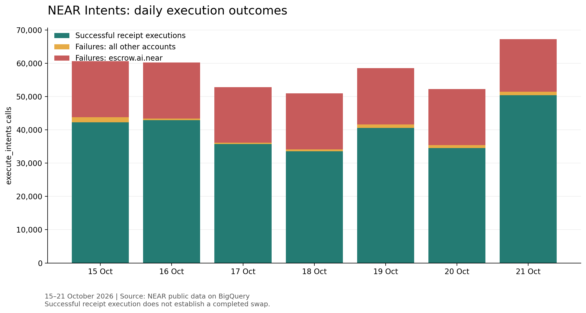
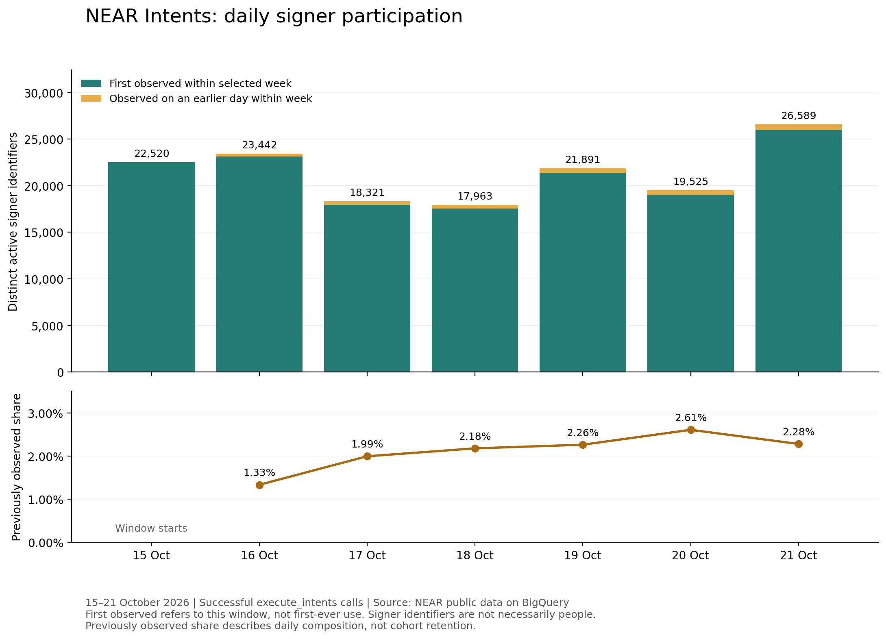
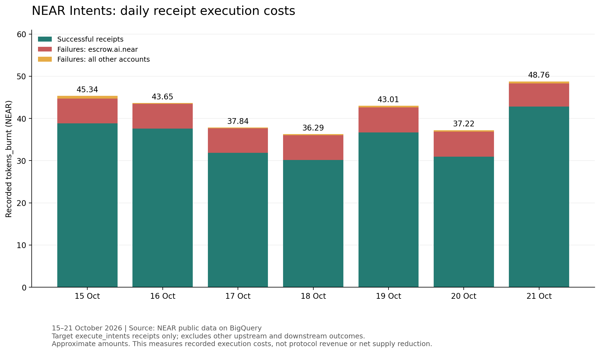
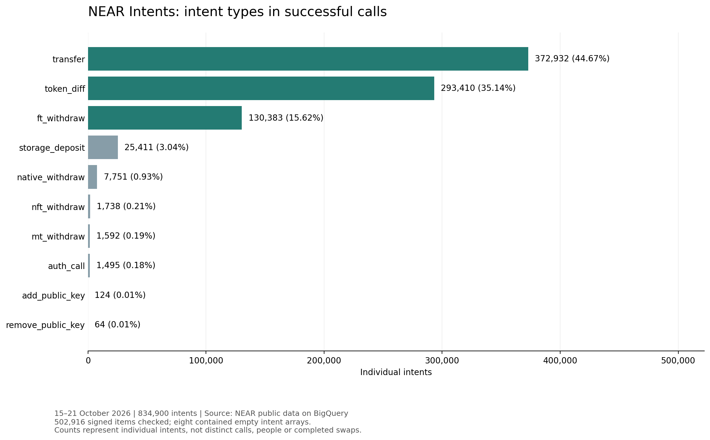
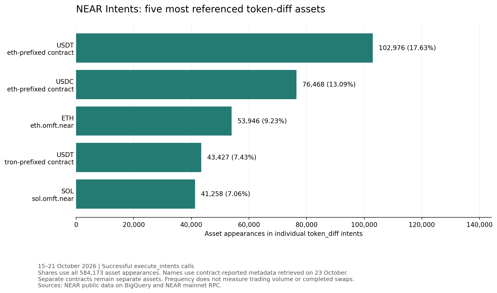

# NEAR Intents: Adoption, Activity and Economic Value

## Research Question

Does NEAR Intents show sustained usage, and how does that activity contribute economic value to NEAR?

This project examines execution outcomes, signer participation and receipt execution costs using public NEAR blockchain data.

## Project Status

Completed exploratory analysis of execute_intents calls to intents.near dated 15–21 October 2026, including execution outcomes recorded through 22 October.

This project provides a reproducible seven-day snapshot of execution outcomes, signer participation, intent types, asset references and receipt execution costs. It does not establish long-term adoption or a complete investment thesis.

## Key Findings

### Failures were concentrated in one submitting account

Across 402,695 calls, 279,856 receipts executed successfully and 122,839 failed, giving an overall failure rate of 30.50%.

escrow.ai.near submitted 116,775 calls, all of which failed. This account contributed 95.06% of the week's failures. Across all other submitting accounts combined, the failure rate was 2.12%.

One inspected failure reported “insufficient balance or overflow.” That example does not establish the cause of the remaining failures or show whether they were retries.



### Most daily signer identifiers had not appeared earlier in the selected week

Successful calls contained 502,916 signed items across 147,573 distinct signer identifiers. Daily active signers ranged from 17,963 to 26,589.

From 16–21 October, signers previously observed on an earlier day within the week represented 1.33%–2.61% of daily active signers.

On 21 October, the ten signers with the highest signed-item counts contributed 54.04% of signed items.

Signer identifiers can represent different types of participants. These counts should not be interpreted as distinct people, and previously observed shares are not cohort retention rates.



### Repeat activity was limited within the selected week

Of 147,573 distinct signer identifiers, 146,301 (99.14%) appeared on only one day. The remaining 1,272 appeared on multiple days, including 131 active on all seven days.

Following the fixed cohort of 22,520 signers active on 15 October, daily activity on the six subsequent days ranged from 259 to 312 signers (1.15%–1.39% of the starting cohort).

These are identifier-level observations over a short window. The cohort contains accounts already active on the starting date, not necessarily newly acquired users. Daily cohort counts are not cumulative returns.

### Failed receipts contributed a smaller share of recorded cost than of calls

Recorded tokens_burnt for the target receipts totalled approximately 292.1178 NEAR:

| Outcome | Receipts | Recorded cost (NEAR) |
|---|---:|---:|
| Successful | 279,856 | 248.8194 |
| Failed | 122,839 | 43.2985 |
| Total | 402,695 | 292.1178 |

Failed receipts represented 30.50% of calls and 14.82% of recorded execution cost. escrow.ai.near accounted for approximately 40.8096 NEAR, or 94.25% of failed-receipt costs.

These figures cover the target receipts only. They do not measure protocol revenue, net token supply reduction or the costs of every upstream and downstream execution outcome.



### Successful calls contained a mixture of intent types

The 502,916 signed items contained 834,900 individual intents across ten types. Transfers accounted for 44.67%, token_diff for 35.14%, and ft_withdraw for 15.62%.

All signed messages parsed successfully and contained intent arrays; eight arrays were empty. Every expanded intent had a nonempty type.

One call can contain several intent types. These counts describe individual intents, not distinct calls or completed swaps.



### Asset references were concentrated

Across 293,410 token_diff intents, 1,626 distinct asset identifiers accounted for 584,173 asset appearances. The five most frequently referenced assets contributed 54.45% of appearances.

Their contracts reported the symbols USDT, USDC, ETH, USDT and SOL. Metadata was retrieved on 23 October, with block references preserved in results/22_top_asset_metadata.json. The two USDT contracts remain separate assets.

These counts measure reference frequency, not trading volume or completed swaps.



## Conclusion

NEAR Intents recorded 402,695 execute_intents calls during the selected week, of which 279,856 executed successfully. Failures were heavily concentrated in one submitting account, making the overall failure rate an incomplete description of activity across accounts.

Most signer identifiers appeared on only one day. This finding describes participation within the selected window; it does not establish user churn, because signer ownership and roles remain unverified.

Successful calls contained multiple intent types and asset references. Calls, signed items and individual intents therefore measure different aspects of activity and cannot be treated as interchangeable measures of completed swaps.

The selected receipts incurred approximately 292.12 NEAR in recorded execution costs. This measures one component of execution activity, but does not establish protocol revenue, net token supply reduction or investment value accruing to NEAR holders.

The evidence establishes activity during the selected week. Sustained adoption and long-term economic value remain open questions.

## Data and Methodology

Data comes from the public BigQuery dataset:

`bigquery-public-data.crypto_near_mainnet_us`

The analysis selects FUNCTION_CALL actions targeting intents.near with method_name equal to execute_intents.

For the selected week:

- Each call corresponded to a distinct receipt.
- Every selected receipt matched exactly one execution outcome.
- SUCCESS_VALUE and FAILURE counts reconciled to the call totals.
- Successful-call arguments were decoded from Base64 and parsed as JSON.
- Signer extraction covered all signed items across seven observed signing formats: nep413, erc191, raw_ed25519, webauthn, tip191, sep53 and ton_connect.
- Cost checks found no missing or negative gas_burnt or tokens_burnt values.

Gas is converted to Tgas by dividing by 10^12. Token amounts are converted from yoctoNEAR to NEAR by dividing by 10^24. Cost fields use floating-point storage, so reported amounts are approximate.

Detailed checks and investigation notes are recorded in [notes/data_checks.md](notes/data_checks.md).

For the five most frequently referenced assets, token-diff amounts were validated as integers and converted into token units using exact decimal arithmetic. Conversions use contract metadata retrieved on 23 October; historical decimals were not independently verified. Each contract remains separate, and the resulting amounts are not presented as trading volume or dollar values.

## Limitations

- The observation window covers seven days.
- Successful receipt execution does not establish a completed swap or successful downstream execution.
- Submitting accounts, signer identifiers, signed items and calls measure different things.
- Signer roles and ownership have not been verified.
- First observed means first seen within the selected window, not first-ever use.
- Failed-call causes and retries have not been established across the dataset.
- Execution costs alone do not establish economic value accruing to NEAR.

## Future Research

- Extend the observation period to assess sustained activity.
- Extend the repeat-participation analysis to longer periods and additional activity cohorts.
- Investigate signer roles and the implications of activity concentration.
- Examine how recorded execution costs relate to NEAR's economic mechanisms.

## Reproducing the Charts

The charts use the CSV exports stored in results/, so reproducing them does not require another BigQuery scan.

With Python 3 and Matplotlib installed, run from the repository root:

```bash
python3 -m pip install -r requirements.txt
python3 analysis/01_daily_execution_chart.py
python3 analysis/03_daily_signer_chart.py
python3 analysis/04_daily_execution_cost_chart.py
python3 analysis/05_intent_type_chart.py
python3 analysis/07_top_asset_chart.py
```

Generated images are saved in charts/. Running the SQL queries requires BigQuery access and may incur query charges.

## Tools

- SQL and Google BigQuery
- Python and Matplotlib
- VS Code
- Git and GitHub

## Repository Structure

- `sql/`: Data checks and analytical queries.
- `results/`: Exported query results.
- `analysis/`: Python scripts for inspection and charts.
- `charts/`: Generated visualisations.
- `notes/`: Research findings, checks and limitations.